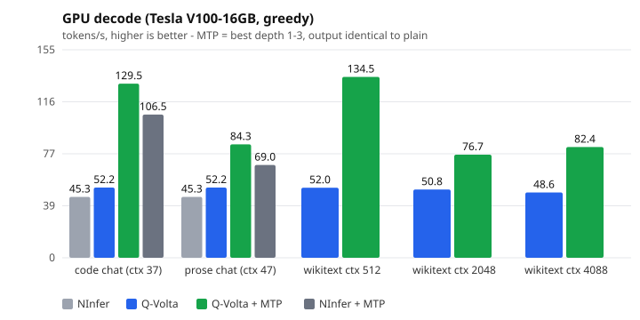
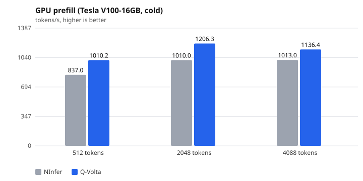

# Q-Volta

An original C++20/CUDA inference engine for **Qwen3.8-27B**: one fast engine for a single **Tesla V100-16GB** (sm_70) and a native **CPU backend** (x86 AVX2 today; ARM/NEON is a design constraint, not yet ported), with **exact** MTP speculative decoding, a single-file model format and an OpenAI-compatible server.

**Status: research code, not a release.** Every number below was measured on one machine, on the date shown, with the raw results in
[`benchmarks/results/`](benchmarks/results). Caveats are listed next to the numbers and in [docs/PERFORMANCE.md](docs/PERFORMANCE.md).

## Headline results

### GPU - Tesla V100-SXM2-16GB, greedy decode, tok/s (higher is better)


| prompt | NInfer plain | NInfer MTP-3 | **Q-Volta plain** | **Q-Volta MTP** (best depth) | MTP vs plain | acceptance (d1 / d2 / d3) |
|---|---:|---:|---:|---:|---:|---|
| code chat, ctx 37 | 45.3 | 106.5 | 52.2 | **129.5** (depth 3) | 2.48x | 1.00 / 0.96 / 0.91 |
| prose chat, ctx 47 | 45.3 | 69.0 | 52.2 | **84.3** (depth 3) | 1.61x | 0.83 / 0.56 / 0.47 |
| wikitext, ctx 512 | - | - | 52.0 | 134.5 (depth 3) | 2.58x | 0.98 / 0.96 / 0.96 |
| wikitext, ctx 2048 | - | - | 50.8 | 76.7 (depth 2) | 1.51x | 0.69 / 0.52 / 0.41 |
| wikitext, ctx 4088 | - | - | 48.6 | 82.4 (depth 2) | 1.69x | 0.75 / 0.67 / 0.55 |

- **Smaller `e1` weights (10.44 GiB)** on the same V100 after the kernel fix (3 runs, ids identical to plain): code plain 57.6 -> MTP-3 **138.2** tok/s (accept 0.94); prose 57.6 -> 88.2 (MTP-2: 95.6); wikitext ctx 512 57.3 -> 132.2; ctx 2048 55.7 -> 83.6 (MTP-2); ctx 4088 54.6 -> 94.1 (MTP-2). E1 has worse quality than E0 on an agentic check (see QUANTIZATION.md). E0 after the fix: plain 52.2, MTP-3 131.8 on code. An intermediate build had a decode regression (-7% plain, -19% MTP-3) from the group-128 kernel generalization; it was bisected and fixed (docs/PERFORMANCE.md).
- MTP output is **bit-identical** to plain greedy decoding (checked on all 60 benchmark runs; `test_cuda_mtp` also compares final logits for depth 1-3).
- Verifying 2 / 3 / 4 tokens costs 1.11x / 1.14x / 1.25x of a single decode step (decode is memory-bandwidth-bound), so accepted drafts are almost free.
- Q-Volta runs 3 repeats per cell, spread < 1% (except plain at ctx 4088: 47.7-50.0). NInfer numbers are from an earlier run the same day, not re-run, timed through its server (ours: `qv_run` decode window).

### GPU - cold prefill, tok/s


| prompt tokens | NInfer | **Q-Volta** | gain |
|---:|---:|---:|---:|
| 512 | 837 | **1010** | +21% |
| 2048 | 1010 | **1207** | +19% |
| 4088 | 1013 | **1136** | +12% |

### CPU - 1x Xeon E5-2683 v4 (AVX2, 32 threads), shared host


| | llama.cpp Q4_K_M (15.8 GiB) | llama.cpp Q3_K_M (12.8 GiB) | **Q-Volta** (12.6 GiB) | **Q-Volta + MTP** |
|---|---:|---:|---:|---:|
| decode, tok/s | 2.16 | 1.86 | 2.6-2.8 today (3.9 on a quieter run) | **3.8-4.5** (1.43-1.60x, acceptance 0.78-0.94) |
| prefill pp512, tok/s | 23.5 | 23.0 | 30.4 | |
| prefill pp2048, tok/s | 20.1 | 19.9 | 26.6 | |


CPU decode is bound by DRAM bandwidth (about 54 GB/s here, 13.6 GB read per token). MTP reads the weights once for two tokens, which is the main lever.

## Honest caveats (read before comparing)
- **Smaller file `e1`**: GPTQ (group 128, compact 8-bit metadata) gives 10.44 GiB with wikitext ppl +9.6% (E0: 12.63 GiB, +12.3%); GPTQ at E0 size reaches +6.1%. It is weaker than E0 on an agentic/tool-calling check (KL 1.34 vs 1.13), see [docs/QUANTIZATION.md](docs/QUANTIZATION.md).
- **Quality is behind the strongest baseline.** Our E0 weights are plain round-to-nearest (3-bit MLP, 4-bit attention/GDN): wikitext perplexity +12% vs BF16 (8.468 -> 9.508, top-1 agreement 84.6%). NInfer's mixed-precision file is +0.3%. Part of our decode lead is simply fewer bytes read (12.6 vs 14.0 GiB). Better quantization (GPTQ-style, bit allocation) is the next big item; speed gained at worse quality is not a clean win.
- The CPU comparison is **not** load-matched: the host was shared (load average 0.1-33), runs are single, and the llama.cpp quants were produced from a Q8_0 intermediate without an importance matrix. Plain-vs-MTP ratios come from back-to-back runs and are the more reliable numbers. Quality (KL) was not compared on CPU.
- Today's plain CPU decode (2.6-2.8) is below an earlier 3.93 run; the cause (DRAM contention from other tenants) is suspected, not confirmed.
- **Context length**: with the int4 KV cache (`--kv int4`: 4.5 bit/element, 18 KiB/token; passkey 6/6 up to 32K, wikitext ppl within 0.1% of fp32 KV at 4K/8K) the largest context that fits on the V100 is about 139K tokens (measured by allocation; 64K and 128K prefill + passkey ran end to end, 2/2 each, which bounds nothing about quality). Prefill: 1131 / 1048 / 902 / 686 tok/s at 4K / 8K / 16K / 32K, about 450 tok/s at 64K and 248 tok/s at 128K (9 minutes). **256K now fits** with the smaller `e1` weights (10.44 GiB, see below) plus int4 KV: 15.2-15.4 of 15.77 GiB used, decode at position 262,001 runs 22.9 tok/s (synthetic KV, speed/VRAM only). A real 250,000-token prefill took 1,701 s (28 min, 147 tok/s) and a passkey hidden at 50% depth was retrieved correctly (1 prompt only: this proves the pipeline works end to end, not retrieval quality; decode speed after a real 250K prefill and MTP at this length are not measured). A host-RAM tier was studied and rejected as the main route (sparse block retrieval loses too much attention mass at 32K+, exact CPU attention costs ~185 ms/token), see [docs/LONG_CONTEXT.md](docs/LONG_CONTEXT.md).
- MTP only speculates exact greedy decoding; no sampling, no adaptive depth, and it is not yet wired into the server. MTP with the pi-merged model was not measured.
- Prefill attention uses tensor cores (3.0-3.9x faster than the fp32 kernel; 4K/8K/16K end-to-end +9% / +15% / +28%), but only ~23% of tensor-core peak; prompts above 16K are not benchmarked against NInfer.

## What works
- **Single-file model format `.qv`**: header + JSON index + bit-plane data in one file (base weights, MTP head). Legacy `.qv.json` + `.qv.bin` pairs still load. `tools/qv_pack.py` merges a pair into one file. Bit-plane, asymmetric group-64 quantization, 2-8 bits per tensor.
- **Converter** `tools/convert.py` (streams BF16 -> Q-Volta, optional PEFT LoRA merge, so the pi adapter works as a merged model; runtime LoRA is planned).
- **CUDA backend**: int8-activation dp4a GEMV decode at 81-99% of HBM peak with CUDA graphs; batched prefill (dequant slab + cuBLAS HGEMM, in-kernel GDN recurrence); split-K decode attention; exact multi-token verify for MTP.
- **CPU backend**: AVX2 int8 kernels, pinned spin-barrier thread pool, huge-page weights, batched prefill, exact MTP.
- **llama-server compatible server** `qv_server` (llama flags and `LLAMA_ARG_*` env, `/completion`, `/infill`, OpenAI chat/completions, `/slots`, `/metrics`, `/props`, `/tokenize`; structural diff-tested against llama-server): see [docs/SERVER.md](docs/SERVER.md) and [docs/SERVER_COMPAT.md](docs/SERVER_COMPAT.md). No tool calling / grammar yet (pending src/jinja, src/grammar), no vision or embeddings, one decoding sequence (requests queue). The CPU path is tested; the CUDA server path compiles but was not run in the server tests.
- Tokenizer matches the `tokenizers` library on 509/509 test strings (498/509 vs transformers `AutoTokenizer`; combining-mark cases differ, documented). Chat template matches 31/31 conversations.
- Tests: 12/12 ctest on the GPU build; full-model golden test passes (KL 6.5e-4 vs the simulated-quantization reference).

## Roadmap
Better quantization (smaller file at equal quality), runtime LoRA inside the model file, 256K context (int4 KV), adaptive MTP depth and a restricted draft vocabulary, server MTP, CPU prefill (fp32 scale overhead), ARM/NEON.

## Build and test
```
cmake -S . -B build -G Ninja -DCMAKE_CUDA_COMPILER=/usr/local/cuda/bin/nvcc && ninja -C build
./build/test_dequant && ./build/test_gdn_seq && ./build/test_attn_seq
python3 -I tests/gen_gemv_cases.py build/gemv_cases && ./build/test_gemv build/gemv_cases q8
```
Full-model golden and benchmarks need the converted model (not included): see `CLAUDE.md`.

## Third-party
Written from scratch. Other engines (NInfer, llama.cpp) were read for design ideas and used only as black-box benchmark baselines; no code copied.
Model weights are not part of this repository and carry their own licences. License for this code: to be chosen by the maintainers.
