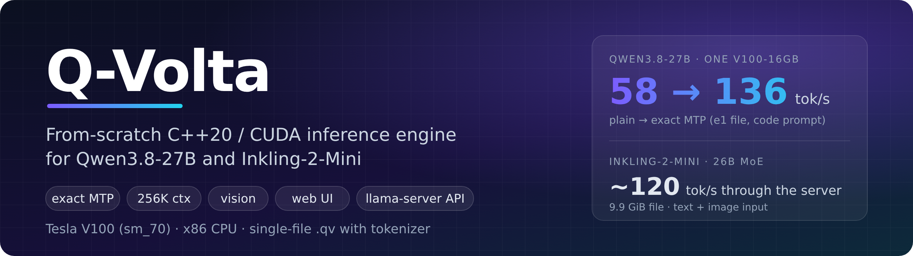
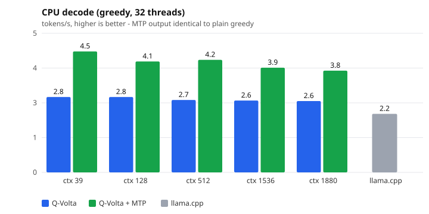
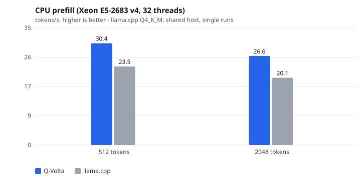

<div align="center">
  
  <br><br>
  
  <p>
    
    
    
    
    
  </p>
  <p>
    <a href="https://huggingface.co/q-project/Qwen3.8-27B-QVolta"></a>
    <a href="https://huggingface.co/q-project/Inkling-2-Mini-QVolta"></a>
  </p>
  <p>
    <a href="https://q-project-lm.github.io/q-volta/"></a>
  </p>
  <p>
    <a href="#at-a-glance">At a glance</a> &middot;
    <a href="#quick-start">Quick start</a> &middot;
    <a href="#headline-results">Results</a> &middot;
    <a href="#comparison-with-llamacpp-on-the-same-v100-measured-2026-11-2123-not-a-claim-of-best">vs llama.cpp</a> &middot;
    <a href="#honest-caveats-read-before-comparing">Caveats</a> &middot;
    <a href="#what-works">Features</a> &middot;
    <a href="#docker">Docker</a> &middot;
    <a href="#documentation">Docs</a>
  </p>
</div>

> [!IMPORTANT]
> **Status: research code, not a release.** Every number was measured on one machine, on the date shown, with raw results in
> [`benchmarks/results/`](benchmarks/results). Caveats sit next to the numbers and in [docs/PERFORMANCE.md](docs/PERFORMANCE.md). We do not claim to be "the best":
> at equal file size we are faster, but llama.cpp's quants are better in quality (see the [comparison](#comparison-with-llamacpp-on-the-same-v100-measured-2026-11-2123-not-a-claim-of-best)).

## At a glance

| | |
|---|---|
| **Fast decode** | Qwen3.8-27B on one V100-16GB: **52-58 tok/s** plain, up to **130-138 tok/s** with exact MTP speculative decoding (output identical to plain greedy) |
| **Small, self-contained file** | one `.qv` file with weights **and** tokenizer, chat template and metadata, **10.4 - 12.6 GiB**, 2-8 bit bit-plane quantization (GPTQ-style); see [docs/QV_FORMAT.md](docs/QV_FORMAT.md) |
| **Long context** | **256K tokens on a 16 GB card** (10.4 GiB weights + int4 KV cache), tensor-core flash prefill |
| **CPU too** | native AVX2 backend with exact MTP: 3.8-4.5 tok/s for the 27B on one old Xeon (1.4-1.6x over plain) |
| **Drop-in server + web UI** | `qv_server`: llama-server flags, OpenAI chat/completions, Anthropic `/v1/messages`, `/v1/responses`, tools, grammars, jinja templates, the embedded llama.cpp web UI, multi-model routing (`--models-preset`) |
| **Second model: Inkling-2-Mini** | 26B MoE, looped layers: ~120 tok/s on the V100 through the server, **image input** (vision sidecar), optional exact MTP (0.55-1.73x, text dependent), see [docs/INKLING_RUN.md](docs/INKLING_RUN.md) |
| **Weights** | [Qwen3.8-27B-QVolta](https://huggingface.co/q-project/Qwen3.8-27B-QVolta), [Inkling-2-Mini-QVolta](https://huggingface.co/q-project/Inkling-2-Mini-QVolta) (with vision and MTP sidecars) |
| **Honest** | every claim has raw data; losses are listed: at equal size llama.cpp's quants are better in quality, see [caveats](#honest-caveats-read-before-comparing) |

## Quick start

```bash
# 1. build (CUDA 12+, CMake 3.24+, Ninja; add -DQV_CUDA=OFF for a CPU-only build)
cmake -S . -B build -G Ninja -DCMAKE_CUDA_COMPILER=/usr/local/cuda/bin/nvcc && ninja -C build

# 2. get a model (ONE self-contained file: weights + tokenizer + chat template + generation defaults)
hf download q-project/Qwen3.8-27B-QVolta qwen38-27b-e1.qv --local-dir models

# 3. serve (OpenAI / llama-server compatible API on :8080)
./build/qv_server --model models/qwen38-27b-e1.qv \
    --backend cuda --kv int4 --max-ctx 131072 --mtp --mtp-depth 2

curl localhost:8080/v1/chat/completions -H 'Content-Type: application/json' \
  -d '{"messages":[{"role":"user","content":"Hello"}],"max_tokens":64}'
```
Docker: `docker build -t q-volta . && docker run --gpus all -p 8080:8080 -v $PWD/models:/models:ro q-volta` (see [Docker](#docker); not yet built by the authors).
Check [docs/SERVER.md](docs/SERVER.md) for which flags are wired (MTP in the server is documented there).

## Headline results

### GPU - Tesla V100-SXM2-16GB, greedy decode, tok/s (higher is better)


| prompt | NInfer plain | NInfer MTP-3 | **Q-Volta plain** | **Q-Volta MTP** (best depth) | MTP vs plain | acceptance (d1 / d2 / d3) |
|---|---:|---:|---:|---:|---:|---|
| code chat, ctx 37 | 45.3 | 106.5 | 52.2 | **129.5** (depth 3) | 2.48x | 1.00 / 0.96 / 0.91 |
| prose chat, ctx 47 | 45.3 | 69.0 | 52.2 | **84.3** (depth 3) | 1.61x | 0.83 / 0.56 / 0.47 |
| wikitext, ctx 512 | - | - | 52.0 | 134.5 (depth 3) | 2.58x | 0.98 / 0.96 / 0.96 |
| wikitext, ctx 2048 | - | - | 50.8 | 76.7 (depth 2) | 1.51x | 0.69 / 0.52 / 0.41 |
| wikitext, ctx 4088 | - | - | 48.6 | 82.4 (depth 2) | 1.69x | 0.75 / 0.67 / 0.55 |

- **Smaller `e1` weights (10.44 GiB)** on the same V100 after the kernel fix (3 runs, ids identical to plain): code plain 57.6 -> MTP-3 **138.2** tok/s (accept 0.94); prose 57.6 -> 88.2 (MTP-2: 95.6); wikitext ctx 512 57.3 -> 132.2; ctx 2048 55.7 -> 83.6 (MTP-2); ctx 4088 54.6 -> 94.1 (MTP-2). E1 has worse quality than E0 on an agentic check (see QUANTIZATION.md). E0 after the fix: plain 52.2, MTP-3 131.8 on code. An intermediate build had a decode regression (-7% plain, -19% MTP-3) from the group-128 kernel generalization; it was bisected and fixed (docs/PERFORMANCE.md).
- MTP output is **bit-identical** to plain greedy decoding (checked on all 60 benchmark runs; `test_cuda_mtp` also compares final logits for depth 1-3).
- Verifying 2 / 3 / 4 tokens costs 1.11x / 1.14x / 1.25x of a single decode step (decode is memory-bandwidth-bound), so accepted drafts are almost free.
- Q-Volta runs 3 repeats per cell, spread < 1% (except plain at ctx 4088: 47.7-50.0). NInfer numbers are from an earlier run the same day, not re-run, timed through its server (ours: `qv_run` decode window).

### GPU - cold prefill, tok/s


| prompt tokens | NInfer | **Q-Volta** | gain |
|---:|---:|---:|---:|
| 512 | 837 | **1010** | +21% |
| 2048 | 1010 | **1207** | +19% |
| 4088 | 1013 | **1136** | +12% |

### CPU - 1x Xeon E5-2683 v4 (AVX2, 32 threads), shared host


| | llama.cpp Q4_K_M (15.8 GiB) | llama.cpp Q3_K_M (12.8 GiB) | **Q-Volta** (12.6 GiB) | **Q-Volta + MTP** |
|---|---:|---:|---:|---:|
| decode, tok/s | 2.16 | 1.86 | 2.6-2.8 today (3.9 on a quieter run) | **3.8-4.5** (1.43-1.60x, acceptance 0.78-0.94) |
| prefill pp512, tok/s | 23.5 | 23.0 | 30.4 | |
| prefill pp2048, tok/s | 20.1 | 19.9 | 26.6 | |



CPU decode is bound by DRAM bandwidth (about 54 GB/s here, 13.6 GB read per token). MTP reads the weights once for two tokens, which is the main lever.

## Comparison with llama.cpp on the same V100 (measured 2026-11-21..23, not a claim of "best")
Full protocol, commands, caveats and raw data: [benchmarks/compare/README.md](benchmarks/compare/README.md). llama.cpp 9d6f04f CUDA build (sm_70), same prompts, 3 interleaved rounds under the GPU lock; quality is measured against one common reference (llama.cpp Q8_0, a near-lossless proxy, not BF16).

| | file GiB | ppl 8x512 (BF16 8.468) | KL to Q8_0 | plain decode tok/s | MTP best (code) | prefill 2048 / 4088 tok/s | max ctx (best KV) |
|---|---:|---:|---:|---:|---:|---:|---:|
| llama.cpp Q3_K_M | 12.77 | 8.905 | 0.054 | 42.3 | 74.8 | 931 / 920 | 132K (q4_0) |
| Q-Volta e0 | 12.63 | 9.511 | 0.102 | 52.2 | 131.7 | 1250 / 1223 | 140K (int4) |
| llama.cpp IQ3_XXS + imatrix | 10.89 | 8.992 | 0.075 | 38.7 | 68.8 | 779 / 775 | 219K (q4_0) |
| Q-Volta e1 | 10.44 | 9.278 | 0.092 | 57.6 | 135.9 | 1250 / 1220 | 267K (int4) |

Reading: at about equal bytes Q-Volta decodes and prefills faster and fits a longer int4 KV cache, while llama.cpp's K-/I-quants are clearly better in quality. Not comparable: KL reference (Q8_0), llama.cpp output of its MTP was not checked for exactness, file sizes differ by 1-4%. ExLlamaV2/V3, vLLM, SGLang: not run on this V100 (reasons in the compare README).

## Honest caveats (read before comparing)
- **Smaller file `e1`**: GPTQ (group 128, compact 8-bit metadata) gives 10.44 GiB with wikitext ppl +9.6% (E0: 12.63 GiB, +12.3%); GPTQ at E0 size reaches +6.1%. It is weaker than E0 on an agentic/tool-calling check (KL 1.34 vs 1.13), see [docs/QUANTIZATION.md](docs/QUANTIZATION.md).
- **Quality is behind the strongest baseline.** Our E0 weights are plain round-to-nearest (3-bit MLP, 4-bit attention/GDN): wikitext perplexity +12% vs BF16 (8.468 -> 9.508, top-1 agreement 84.6%). NInfer's mixed-precision file is +0.3%. Part of our decode lead is simply fewer bytes read (12.6 vs 14.0 GiB). Better quantization (GPTQ-style, bit allocation) is the next big item; speed gained at worse quality is not a clean win.
- The CPU comparison is **not** load-matched: the host was shared (load average 0.1-33), runs are single, and the llama.cpp quants were produced from a Q8_0 intermediate without an importance matrix. Plain-vs-MTP ratios come from back-to-back runs and are the more reliable numbers. Quality (KL) was not compared on CPU.
- Today's plain CPU decode (2.6-2.8) is below an earlier 3.93 run; the cause (DRAM contention from other tenants) is suspected, not confirmed.
- **Context length**: with the int4 KV cache (`--kv int4`: 4.5 bit/element, 18 KiB/token; passkey 6/6 up to 32K, wikitext ppl within 0.1% of fp32 KV at 4K/8K) the largest context that fits on the V100 is about 139K tokens (measured by allocation; 64K and 128K prefill + passkey ran end to end, 2/2 each, which bounds nothing about quality). Prefill: 1131 / 1048 / 902 / 686 tok/s at 4K / 8K / 16K / 32K, about 450 tok/s at 64K and 248 tok/s at 128K (9 minutes). **256K now fits** with the smaller `e1` weights (10.44 GiB, see below) plus int4 KV: 15.2-15.4 of 15.77 GiB used, decode at position 262,001 runs 22.9 tok/s (synthetic KV, speed/VRAM only). A real 250,000-token prefill took 1,701 s (28 min, 147 tok/s) and a passkey hidden at 50% depth was retrieved correctly (1 prompt only: this proves the pipeline works end to end, not retrieval quality; decode speed after a real 250K prefill and MTP at this length are not measured). A host-RAM tier was studied and rejected as the main route (sparse block retrieval loses too much attention mass at 32K+, exact CPU attention costs ~185 ms/token), see [docs/LONG_CONTEXT.md](docs/LONG_CONTEXT.md).
- MTP only speculates exact greedy decoding; no sampling and no adaptive depth; in the server it applies to temperature-0 requests only. MTP with the pi-merged model was not measured.
- Prefill attention uses tensor cores (3.0-3.9x faster than the fp32 kernel; 4K/8K/16K end-to-end +9% / +15% / +28%), but only ~23% of tensor-core peak; prompts above 16K are not benchmarked against NInfer.

## What works
- **Single-file model format `.qv`**: header + JSON index + bit-plane data in one file (base weights, MTP head). Legacy `.qv.json` + `.qv.bin` pairs still load. Since format_version 2 the file also embeds `tokenizer.json`, `chat_template.jinja`, `generation_config.json` and a `meta` object (GGUF style): `qv_server --model x.qv` needs no `--tokenizer`; `tools/qv_embed.py` adds them to an existing file without re-quantizing. Spec: docs/QV_FORMAT.md. `tools/qv_pack.py` merges a pair into one file. Bit-plane, asymmetric group-64 quantization, 2-8 bits per tensor.
- **Converter** `tools/convert.py` (streams BF16 -> Q-Volta, optional PEFT LoRA merge, so the pi adapter works as a merged model; runtime LoRA is planned).
- **CUDA backend**: int8-activation dp4a GEMV decode at 81-99% of HBM peak with CUDA graphs; batched prefill (dequant slab + cuBLAS HGEMM, in-kernel GDN recurrence); split-K decode attention; exact multi-token verify for MTP.
- **CPU backend**: AVX2 int8 kernels, pinned spin-barrier thread pool, huge-page weights, batched prefill, exact MTP.
- **llama-server compatible server** `qv_server` (llama flags and `LLAMA_ARG_*` env, `/completion`, `/infill`, OpenAI chat/completions, `/slots`, `/metrics`, `/props`, `/tokenize`; structural diff-tested against llama-server): see [docs/SERVER.md](docs/SERVER.md) and [docs/SERVER_COMPAT.md](docs/SERVER_COMPAT.md). Tool calling, JSON mode and GBNF grammars via src/jinja + src/grammar; the llama.cpp web UI is embedded (`GET /`, screenshots in docs/img/webui_*.png), plus Anthropic `/v1/messages` and `/v1/responses`; image input for Inkling-2-Mini (`image_url`, see docs/INKLING_VISION.md); no embeddings, one decoding sequence (requests queue). The CPU path is tested; the CUDA server path compiles but was not run in the server tests.
- Tokenizer matches the `tokenizers` library on 509/509 test strings (498/509 vs transformers `AutoTokenizer`; combining-mark cases differ, documented). Chat template matches 31/31 conversations.
- Tests: 12/12 ctest on the GPU build; full-model golden test passes (KL 6.5e-4 vs the simulated-quantization reference).

## Roadmap
Done recently: 256K context with int4 KV, exact MTP in the server, single-file `.qv` with tokenizer, web UI, Inkling vision and MTP, act-order GPTQ recipe e1b1 (measured, not yet published). Next: quantization quality at equal size (the gap to llama.cpp), concurrent requests in the server (multi-sequence decoding, in development), runtime LoRA inside the model file, faster Inkling MTP verification, CPU prefill (fp32 scale overhead), ARM/NEON.

## Inkling-2-Mini
The engine also runs thinkingmachines/Inkling-2-Mini (MoE, looped layers) on the V100 and the CPU backend: ~120 tok/s decode on the V100 through the server; exact MTP speculative decoding (sidecar drafter) gives about 1.25x on code at short context and 0.55-1.73x over the measured matrix (docs/INKLING_MTP.md). How to run it and what was measured: [docs/INKLING_RUN.md](docs/INKLING_RUN.md); design and parity with the Hugging Face implementation: [docs/INKLING_SPEC.md](docs/INKLING_SPEC.md), [docs/INKLING_ENGINE.md](docs/INKLING_ENGINE.md).

### Inkling vision (image input)
`qv_server` accepts OpenAI `image_url` content parts for Inkling-2-Mini when the vision sidecar `inkling2-mini-vision.qv` (0.64 GB, made by `tools/convert_inkling_vision.py`) sits next to the model (or `--vision-file PATH`).
Preprocessing, the ViT (23 layers, 2-D RoPE), the projector and the CUDA / CPU encoders follow the Hugging Face PR #51050 tower: embedding error vs the fp32 HF tower 0.06-0.4 % relative L2 on CUDA (HF's own bf16 run differs by 1.3-5 %), 1e-5 on the CPU path.
`data:` URLs and files below `--image-root` work by default; http(s) only with `--allow-remote-images` (SSRF-guarded). One image costs `ceil(h/40)*ceil(w/40)` tokens (224x224 = 36, 1024x1024 = 676). Encoder time on the V100: 5.5 ms (224x224), 23 ms (512x512), 185 ms (1024x1024).
Spec, validation and limits: [docs/INKLING_VISION.md](docs/INKLING_VISION.md).

## Docker
A `Dockerfile` (GPU and CPU-only targets) and `docker-compose.yml` are provided, see [docs/DOCKER.md](docs/DOCKER.md) (written without a container runtime on hand: not yet built by the authors).

## Build and test
```
cmake -S . -B build -G Ninja -DCMAKE_CUDA_COMPILER=/usr/local/cuda/bin/nvcc && ninja -C build
./build/test_dequant && ./build/test_gdn_seq && ./build/test_attn_seq
python3 -I tests/gen_gemv_cases.py build/gemv_cases && ./build/test_gemv build/gemv_cases q8
```
Full-model golden and benchmarks need the converted model (not included): see `CLAUDE.md`.

## Documentation
| topic | where |
|---|---|
| performance methodology and raw numbers | [docs/PERFORMANCE.md](docs/PERFORMANCE.md), [benchmarks/](benchmarks) |
| quantization recipes and quality | [docs/QUANTIZATION.md](docs/QUANTIZATION.md) |
| long context (int4 KV, tiering study) | [docs/LONG_CONTEXT.md](docs/LONG_CONTEXT.md) |
| server, llama-server compatibility, jinja, grammar | [docs/SERVER.md](docs/SERVER.md), [docs/SERVER_COMPAT.md](docs/SERVER_COMPAT.md), [docs/JINJA.md](docs/JINJA.md), [docs/GRAMMAR.md](docs/GRAMMAR.md) |
| CPU engine | [docs/CPU_OPTIMIZATION.md](docs/CPU_OPTIMIZATION.md) |
| Inkling-2-Mini | [docs/INKLING_RUN.md](docs/INKLING_RUN.md), [spec](docs/INKLING_SPEC.md), [format](docs/INKLING_FORMAT.md), [engine](docs/INKLING_ENGINE.md) |
| comparison with llama.cpp | [benchmarks/compare/README.md](benchmarks/compare/README.md) |
| self-contained `.qv` format | [docs/QV_FORMAT.md](docs/QV_FORMAT.md) |
| Inkling MTP and vision | [docs/INKLING_MTP.md](docs/INKLING_MTP.md), [docs/INKLING_VISION.md](docs/INKLING_VISION.md) |
| multi-model routing | [docs/ROUTING.md](docs/ROUTING.md) |
| Docker | [docs/DOCKER.md](docs/DOCKER.md) |
| progress log | [docs/PROGRESS.md](docs/PROGRESS.md) |

## Third-party
Written from scratch (one vendored public-domain header, `stb_image.h`, for image decoding: see [THIRD_PARTY.md](THIRD_PARTY.md)). Other engines (NInfer, llama.cpp) were read for design ideas and used only as black-box benchmark baselines; no code copied.
Model weights are not part of this repository and carry their own licences. License for this code: to be chosen by the maintainers.
